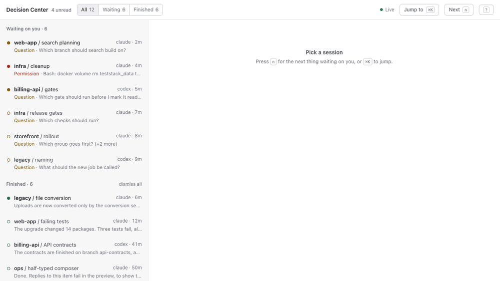
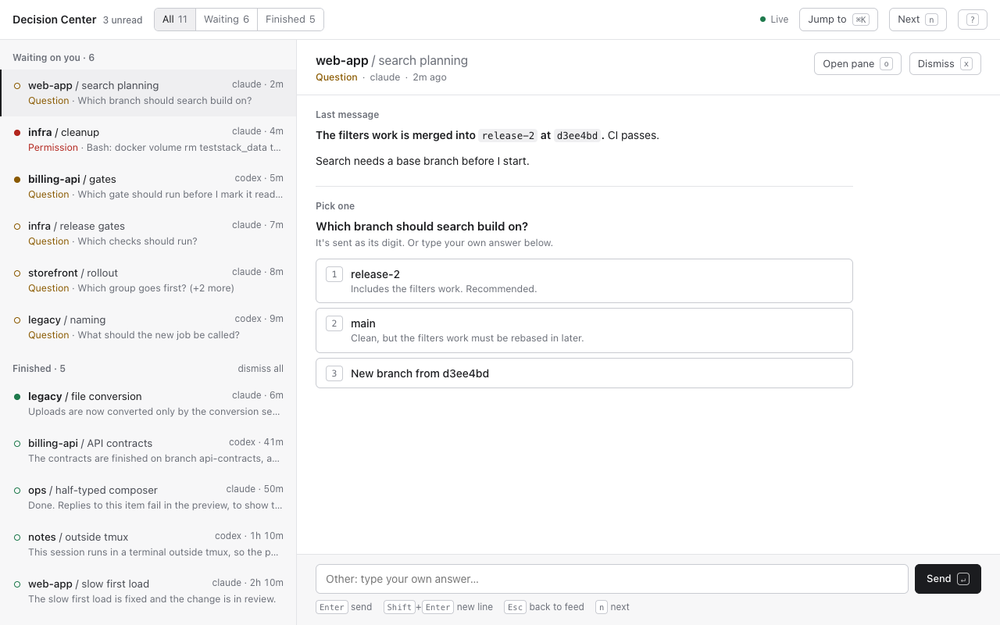
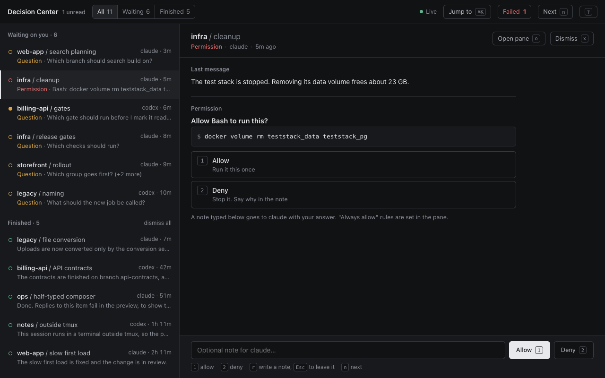
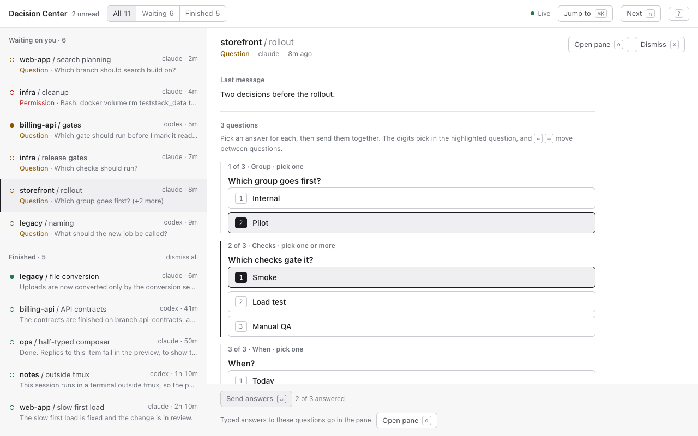
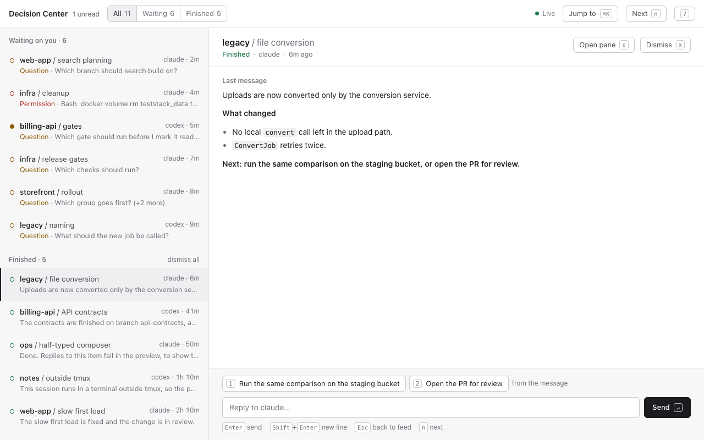
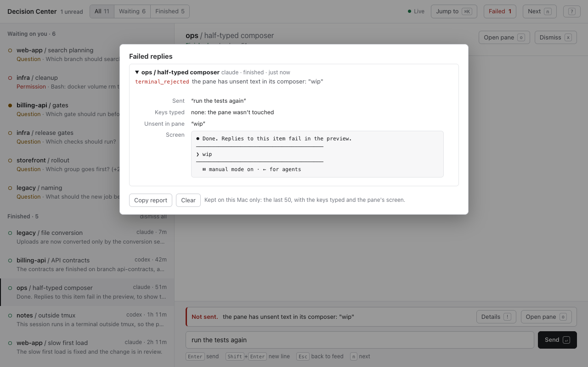

# Decision Center

[](https://github.com/PedroFMBranco/decision-center/actions/workflows/test.yml)

One page that lists every Claude Code and Codex session on this machine that waits on you, and lets you answer from the browser.



An agent that asks a question or needs permission stops until you answer. With several sessions in several terminals, an ask can wait a long time before you see it. Decision Center puts every waiting session in one list, so you answer each one without looking for its terminal.

A session lands in the feed when it asks a question, needs permission, or finishes a turn. Pick an item to read the session's last message, then reply. The reply is typed into the session's tmux pane.

- [Quick start](#quick-start)
- [How it works](#how-it-works)
- [Requirements](#requirements)
- [Install](#install)
- [Use](#use)
- [Commands](#commands)
- [What it stores and runs](#what-it-stores-and-runs)
- [Limits](#limits)
- [Develop](#develop)

## Quick start

```sh
git clone git@github.com:PedroFMBranco/decision-center.git
cd decision-center
node dist/decision-center.mjs install     # add the hooks to Claude Code and Codex
node dist/decision-center.mjs serve       # serve the feed on http://127.0.0.1:47823
```

In a second terminal, start an agent that the feed can reply to:

```sh
node dist/decision-center.mjs run claude  # or: run codex
```

Open `http://127.0.0.1:47823`. The session shows up when it next asks, needs permission, or finishes.

## How it works

- **Hooks report.** `install` adds a hook to Claude Code and to Codex. On each hook event, the hook appends one line to a file in `~/.decision-center`.
- **The server reads.** `serve` turns those files into the feed and serves the page on `127.0.0.1`.
- **tmux replies.** A reply is typed into the session's tmux pane, as if you typed it there. A session outside tmux still shows in the feed, but you can't reply to it from the page.

## Requirements

- macOS or Linux.
- Node 22 or later.
- tmux 3.2 or later. Replies reach an agent that runs inside tmux. `decision-center run claude` starts it that way from any terminal.
- Claude Code, Codex, or both.
- For **Suggest replies** only: Claude Code installed and logged in. See [Quick replies](#quick-replies).

## Install

1. Clone this repo. `dist/` is committed, so there is nothing to build.
2. Add the hooks:

   ```sh
   node dist/decision-center.mjs install --dry-run   # shows what would change
   node dist/decision-center.mjs install
   ```

   This adds one entry per hook event to `~/.claude/settings.json` and `~/.codex/hooks.json`. Every other entry stays where it is. Each file is backed up beside itself before it changes, as `<file>.decision-center-backup-<time>`. Running `install` again changes nothing. Pass `--claude-settings <path>` or `--codex-hooks <path>` to touch only the file you name.
3. Codex asks you to trust new or changed hooks the next time it starts. Accept the prompt. Untrusted hooks don't run, and the feed then sees no Codex sessions.

To type `decision-center` instead of the full path, add an alias such as `alias decision-center='node ~/src/decision-center/dist/decision-center.mjs'`. The rest of this page uses that short form.

### Move the folder or upgrade Node

`install` copies the hook to `~/.decision-center/hook.mjs`, and the hook command is the absolute path of your `node` plus that copy. You can move or rename this folder afterwards.

The hook runs with the `node` recorded at install. When that one is gone, after a Node upgrade for example, it uses `node` from `PATH`, then `/opt/homebrew/bin/node`, `/usr/local/bin/node` or `/usr/bin/node`.

Run `install` again after an update. `decision-center status` says so when the recorded node or the hook file is gone.

### Uninstall

`decision-center uninstall` removes the entries and leaves the rest of each file alone.

## Use



1. Run `decision-center serve` in a terminal. It serves the feed on `http://127.0.0.1:47823` and runs until you stop it with `Ctrl-C`. Nothing starts it for you.
2. Run `decision-center open`, or open that address yourself.
3. Pick an item. Questions and permission asks come first under **Waiting on you**, then **Finished**, then **Session closed**.
4. Reply with a quick reply, an option number, or free text. Each reply waits 3 s so you can undo it with `Esc`, then it's typed into the pane and the view moves to the next item.

Press `?` for every shortcut. `⌘K` jumps to any item. **Open pane** (`o`) selects the session's tmux window and pane, and switches your tmux client to it.

`decision-center status` shows the home folder, whether the hooks are installed, how many sessions it has seen, the tmux version and whether the server runs.

### Answer a permission ask



Permission asks get **Allow** (`1`) and **Deny** (`2`), with an optional note that goes to the agent with your answer. "Always allow" rules are set in the pane.

### Answer a question

A question shows its options as numbered rows. Press the digit, or type your own answer.



A question with several parts shows one row of options per part: pick in each, then send them together.

Some things are left to the pane itself, behind an **Open pane** button: Codex questions with several parts, parts with no options to pick, and typed answers to those questions.

### Reply to a finished turn



A finished item shows the session's last message and a reply box. What you send becomes the session's next prompt.

#### Quick replies

Reply chips come from the end of the session's last message. Clicking a chip fills the text box. It doesn't send.

The hook gives each interactive session one rule when it starts: end a turn with a line of likely replies, in this form. An interactive session is Claude Code in a terminal or the Codex terminal UI.

```
Replies: "Run the tests again" | "Open the PR" | "Show me the diff first"
```

The feed turns that line into up to 3 chips and leaves it out of the message it shows. The line still shows in the session's own terminal. To switch the rule off for a Claude Code session, start it with `DECISION_CENTER_REPLY_LINE=off` in its environment. Codex has no switch for one session, see [Limits](#limits).

Without that line, the feed reads the message itself: if it ends with a `Next:` line or a numbered list, the first 3 items become chips.

A `Next:` line becomes a chip only when it reads as something you could send back. A line that quotes a reply, such as `Next: say "tag"`, gives the quoted text. A line that tells you what to do, such as `Next: tell me which branch to use`, gives no chip.

**Suggest replies** asks Claude Haiku for chips when the message has none. It runs your own `claude` CLI (`claude -p --model haiku`, with no settings, hooks, MCP servers, tools or saved session). It needs Claude Code installed and logged in, and each press costs about $0.005 on your Claude account. Without Claude Code, the button shows an error and everything else still works.

### Start an agent from any terminal

```sh
decision-center run claude          # or: decision-center run codex, with any arguments
```

`run` starts the agent inside tmux, in the terminal window you typed it in, so the feed can reply to it. It works in Terminal, iTerm, Ghostty and any other terminal. Inside tmux already, it runs the agent as it is.

The session runs on a tmux server of its own, named `decision-center`, so your own tmux and its settings are untouched. That server shows no status line and adds no `Esc` delay. Two things differ from a bare terminal:

- The mouse wheel scrolls tmux's history. While you are scrolled up, the pane is in copy mode and the feed refuses to reply. Press `q` to leave it.
- Dragging selects text through tmux. On macOS the selection is copied to the clipboard when you release the button. Hold `Option` (Terminal) or `Shift` (most others) while dragging for the terminal's own selection.

Closing the terminal window ends the session.

Only a call that opens a session goes through tmux. A piped call, a print or version flag (`claude -p`, `--version`, `--help`) and a subcommand (`claude mcp list`, `codex exec`) run as they are, so their output stays on screen.

#### Make plain `claude` and `codex` start this way

Run `decision-center install --alias`. It adds two shell functions, in a marked block, to `~/.zshrc` and to `~/.bashrc` when you have one, and backs each file up first. The functions run the agent as it is when Node or this folder is gone. `uninstall` removes the block. Without `--alias`, `install` edits no shell file.

### Sessions outside tmux

Hooks fire in every terminal, so these sessions still show up in the feed. Replies and **Open pane** are refused with "this session is not running in tmux; reply in its terminal".

### When a reply is refused

Before it types anything, Decision Center reads the pane's screen. It refuses to reply when the prompt it expects isn't there, when you have unsent text in the composer, or when the pane is in tmux copy mode.



When a reply doesn't go through, the item shows **Not sent** with the reason. **Details** (or `!`) opens the failed-replies list, and a **Failed N** button in the header opens it too. Each entry shows what you sent, the error, the keys already typed into the pane, any unsent text in the pane's composer, and the bottom of the pane's screen at that moment. **Copy report** puts them all on the clipboard as JSON. The last 50 are kept in `failures.json` in the home folder and are never sent anywhere.

### Alerts

Decision Center raises no banners or sounds of its own. The unread count shows in the feed and in the tab title, for example `(3) Decision Center`.

### Appearance

The page follows the system's light or dark mode. The `?` sheet has a **Theme** button to fix it to one, and a **Density** button for a more compact feed.

## Commands

| Command | What it does |
|---|---|
| `serve` | Runs the feed server in the foreground. It is the default command. |
| `open` | Opens the feed in your browser. |
| `run <agent> [args]` | Starts an agent inside tmux, from any terminal, so the feed can reply to it. |
| `install [--dry-run] [--alias] [--claude-settings <path>] [--codex-hooks <path>]` | Adds the hooks to Claude Code and Codex. With `--alias`, also makes `claude` and `codex` start through `run`. |
| `uninstall [--dry-run] [--claude-settings <path>] [--codex-hooks <path>]` | Removes the hooks again. |
| `status` | Shows the home folder, hooks, sessions and tmux. |
| `hook <claude\|codex>` | Records one hook call. Agents run this. |

| Environment variable | Default | Meaning |
|---|---|---|
| `DECISION_CENTER_PORT` | `47823` | The port the server listens on. |
| `DECISION_CENTER_HOME` | `~/.decision-center` | The home folder. |

## What it stores and runs

The home folder is `~/.decision-center`, or `$DECISION_CENTER_HOME`. The folder is mode 700 and its files are mode 600.

- `sessions/<agent>-<session id>.jsonl`: one line per hook call. Each line holds the hook event, the time, the session id, the working folder, the transcript path, the subagent id, and for Claude the tmux pane and the agent's process id. It also holds the prompt (first 8 KB), the agent's last message (first 64 KB), the tool name, a short hash that names the tool call, and a summary of up to 200 characters (the command or the file path). Question tools also keep their questions and options. Tool output is never written. Files with no event for 7 days are deleted when the server starts.
- `flags.json`: which items you read or dismissed.
- `failures.json`: the last 50 failed replies.

The hook runs on every hook call of every session. It reads the payload, appends one line, and exits 0, whatever happens. It prints nothing, with one exception: when an interactive session starts, it prints the reply-line rule from [Quick replies](#quick-replies), and the agent adds that text to the session's context. For Codex, it first reads the first line of the session's transcript to see which program started the session. It makes no network calls and starts no processes. It takes about 25 ms per call, the median of 35 runs of `node dist/hook.mjs` on an Apple Silicon Mac, not counting the shell the agent starts it from. About 20 ms of that is Node starting up.

The server runs these programs:

- `tmux` to list panes, read a pane's screen, type replies and select a pane.
- `ps`, to see whether a session's process still runs, and `lsof`, to find the folder a Codex process runs in.
- `claude`, when you press **Suggest replies**.

The server listens on `127.0.0.1` only. Set `DECISION_CENTER_PORT` to use another port. Nothing leaves your machine except the Suggest replies call, which goes to Anthropic through your own Claude Code login.

## Limits

- Headless Claude runs (`claude -p`, SDK agents) have no terminal, so they never show in the feed. A `codex exec` run started from a terminal does show, as its own item.
- Denying or cancelling an ask in the pane, or pressing `Esc` on a question, fires no hook. In tmux, the feed reads the pane's screen and drops the ask once the prompt is gone, within 30 s. When the pane says the turn was interrupted, the session then shows as finished, so you can tell the agent what to do instead. Outside tmux, the ask stays in the feed until the session's next hook.
- A Codex turn that fails (a refused model, a dropped connection) or is interrupted fires no hook. In tmux, the feed reads the pane's screen, and the session shows as finished with Codex's notice as its message. Outside tmux, the session shows nothing until its next turn ends.
- Codex starts sessions of its own in `~/.codex/memories` to write its memories. They stay out of the feed.
- A Codex hook runs in a shared background process, so it can't say which pane its session is in. Decision Center finds the pane from the `codex` process on the pane's terminal that runs in the session's folder. With two Codex sessions in one folder it can't always tell them apart, and then the session shows as if it ran outside tmux.
- A Codex session counts as closed once no `codex` process with a terminal runs in its folder. Codex ends sessions without a hook, so a closed Codex session leaves the feed only on the next refresh, within 30 s.
- The reply-line rule reaches interactive sessions only. A scripted run (`claude -p`, `codex exec`, an SDK agent) never gets it, because a program reads its output. Claude Code marks its interactive CLI in the hook's environment. Codex doesn't, so the hook reads the transcript's first line and gives the rule only to a session that a person started in the terminal UI (`originator` is `codex-tui` and `thread_source` is `user`). The Codex desktop app, editor plugins, and threads that Codex starts for itself get no rule.
- Codex stores the rule in the session's history. A terminal session that a script later resumes with `codex exec resume` still carries it.
- `DECISION_CENTER_REPLY_LINE=off` doesn't work per session in Codex. A Codex hook runs in a shared background process, so it never sees the environment of the terminal the session runs in.
- The rule is an instruction, so an agent can skip it, mostly late in a long session. The feed then reads the message as before.
- With Claude Code's `auto` permission mode, permission asks never appear, so the feed shows none.

## Develop

```sh
npm install
npm test          # typecheck, unit tests, bundle freshness
npm run build     # rebuild dist/decision-center.mjs and dist/hook.mjs; commit them
npm run preview   # serve the page against fixtures
```

The screenshots in `docs/screenshots/` come from `npm run preview` at 1280 by 800, so they show fixture data and no real session. `docs/demo.gif` and `docs/social-preview.png` come from the same preview.

GitHub Actions runs `npm test` on every push to `main` and on every pull request, on Linux with tmux installed.

## License

MIT
